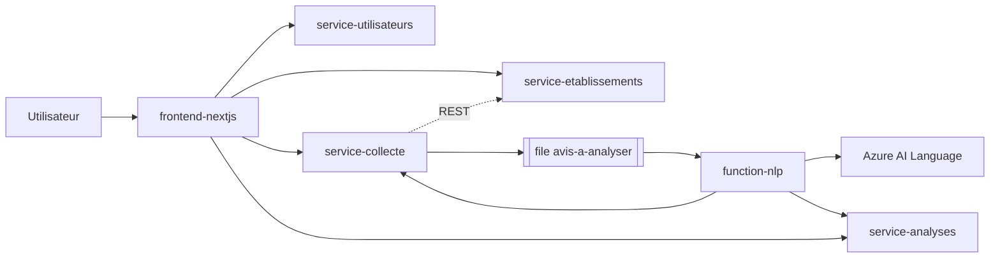

# Beacom-saas

SaaS d'e-réputation : collecte d'avis sur des établissements, analyse de sentiment automatique (Azure AI Language) et tableau de bord.
Projet « Cloud Startup Challenge » : architecture microservices avec IaaS, PaaS et FaaS sur Microsoft Azure.

## Architecture



| Dossier | Rôle | Hébergement | Base |
|---|---|---|---|
| `service-utilisateurs` | Connexion, rôles, JWT | App Service (PaaS) | `db_utilisateurs` |
| `service-etablissements` | Référentiel des établissements | App Service (PaaS) | `db_etablissements` |
| `service-collecte` | Reçoit les avis, les met en file | App Service (PaaS) | `db_collecte` |
| `service-analyses` | Résultats et indicateurs | App Service (PaaS) | `db_analyses` |
| `function-nlp` | Analyse de sentiment sur événement | Azure Functions (FaaS) | aucune (passe par les API) |
| `frontend-nextjs` | Interface web et passerelle d'API (à développer) | App Service (PaaS) | - |
| PostgreSQL | Les 4 bases | VM Ubuntu 22.04 (IaaS) | - |

Chaque service est propriétaire de sa base et l'expose par son API.

## Documentation (livrables du TP)

| Document | Contenu |
|---|---|
| [docs/01-produit.md](docs/01-produit.md) | Pitch, expression du besoin, backlog |
| [docs/02-architecture.md](docs/02-architecture.md) | Découpage, communications, IaaS / PaaS / FaaS, données, limites |
| [docs/03-securite.md](docs/03-securite.md) | Analyse de sécurité |
| [docs/04-finops.md](docs/04-finops.md) | Estimation des coûts et leviers d'économie |
| [docs/05-deploiement.md](docs/05-deploiement.md) | Déploiement Azure, GitHub Actions, scénario de démonstration |

## Démarrage local

1. Créer les bases : `infra/sql/01...04_*.sql` (une base par fichier).
2. Dans chaque dossier `service-*` : copier `.env.example` en `.env`, installer `requirements.txt`, lancer `uvicorn main:app --port <port>`
   (8000 utilisateurs, 8001 établissements, 8002 collecte, 8003 analyses).
3. Le `JWT_SECRET` doit être identique dans les quatre services.
4. Lancer `function-nlp` avec `func start` (voir son README).

## Accès à PostgreSQL

Le port 5432 n'est pas ouvert sur Internet. En local, ouvrez un tunnel SSH :

```bash
ssh -L 5432:localhost:5432 azureuser@<IP_VM>
```

Sur Azure, les App Service joignent la VM par son adresse privée via l'intégration au réseau virtuel (voir `docs/05-deploiement.md`).

## Sécurité

Aucun secret dans le dépôt : `.env`, `local.settings.json` et les profils de publication sont ignorés ou stockés dans les
paramètres Azure / secrets GitHub. Si un secret est commité par erreur, renouvelez-le.

## CI/CD

`.github/workflows/deploy.yml` : tests, puis déploiement des 4 services et de la Function à chaque push sur `main`,
puis vérification de `/health`.
