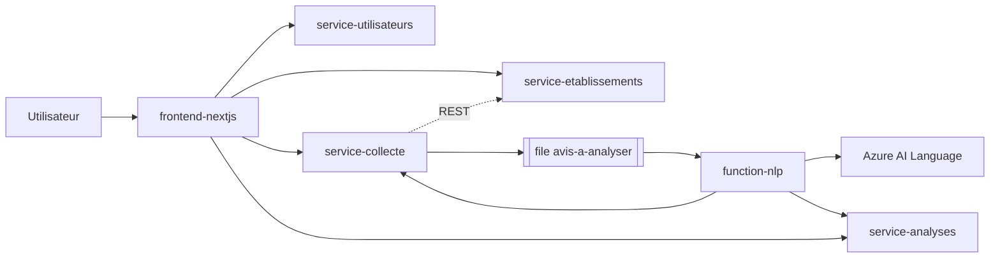

# Beacom-saas

SaaS d'e-réputation : collecte d'avis sur des établissements, analyse de sentiment automatique (Azure AI Language) et tableau de bord.
Projet « Cloud Startup Challenge » : architecture microservices avec IaaS, PaaS et FaaS sur Microsoft Azure.

## Architecture



| Dossier | Rôle | Hébergement | Base |
|---|---|---|---|
| `service-utilisateurs` | Connexion, rôles, JWT | App Service (PaaS) | `db_utilisateurs` |
| `service-etablissements` | Référentiel des établissements | App Service (PaaS) | `db_etablissements` |
| `service-collecte` | Reçoit les avis, les met en file | App Service (PaaS) | `db_collecte` |
| `service-analyses` | Résultats et indicateurs | App Service (PaaS) | `db_analyses` |
| `function-nlp` | Analyse de sentiment sur événement | Azure Functions (FaaS) | aucune (passe par les API) |
| `frontend-nextjs` | Interface web (Next.js) et passerelle d'API | App Service (PaaS, Node 20) | - |
| PostgreSQL | Les 4 bases | VM Ubuntu 22.04 (IaaS) | - |

Chaque service est propriétaire de sa base et l'expose par son API.

**Multi-clients.** Chaque client de Beacom est une *organisation* (créée par `POST /auth/inscription`) avec un plan
`gratuit`, `pro` ou `entreprise`. Le jeton JWT porte l'organisation, et chaque service filtre toutes ses lectures et
écritures dessus : un client ne voit jamais les données d'un autre (voir `docs/02-architecture.md`).

## Documentation (livrables du TP)

| Document | Contenu |
|---|---|
| [docs/01-produit.md](docs/01-produit.md) | Pitch, expression du besoin, backlog |
| [docs/02-architecture.md](docs/02-architecture.md) | Découpage, communications, IaaS / PaaS / FaaS, données, limites |
| [docs/03-securite.md](docs/03-securite.md) | Analyse de sécurité |
| [docs/04-finops.md](docs/04-finops.md) | Estimation des coûts et leviers d'économie |
| [docs/05-deploiement.md](docs/05-deploiement.md) | Déploiement Azure, GitHub Actions, scénario de démonstration |
| [docs/06-observabilite.md](docs/06-observabilite.md) | Journaux, disponibilité, performance, alertes, diagnostic (KQL) |

## Démarrage local

1. Créer les bases : `infra/sql/01...04_*.sql` (une base par fichier). Une base créée avec une version antérieure
   se met à jour avec les migrations idempotentes de `infra/sql/migrations/` (voir son README).
2. Dans chaque dossier `service-*` : copier `.env.example` en `.env`, installer `requirements.txt`, lancer `uvicorn main:app --port <port>`
   (8000 utilisateurs, 8001 établissements, 8002 collecte, 8003 analyses).
3. Le `JWT_SECRET` doit être identique dans les quatre services.
4. Lancer `function-nlp` avec `func start` (voir son README).
5. Lancer l'interface : voir `frontend-nextjs/README.md` (Docker, sans rien installer), puis créer un compte sur `/inscription`.

## Tests

```bash
./scripts/lancer-tests.sh              # tous les services, dans Docker (PostgreSQL 14 + Python 3.11)
./scripts/lancer-tests.sh collecte     # un seul : utilisateurs, etablissements, collecte, analyses, infra, function
```

Les tests tournent contre un vrai PostgreSQL, comme en CI. Ils vérifient notamment, dans chaque service, qu'un utilisateur
de l'organisation A reçoit 404 sur une ressource de l'organisation B.

## Accès à PostgreSQL

Le port 5432 n'est pas ouvert sur Internet. En local, ouvrez un tunnel SSH :

```bash
ssh -L 5432:localhost:5432 azureuser@<IP_VM>
```

Sur Azure, les App Service joignent la VM par son adresse privée via l'intégration au réseau virtuel (voir `docs/05-deploiement.md`).

## Sécurité

Aucun secret dans le dépôt : `.env`, `local.settings.json` et les profils de publication sont ignorés ou stockés dans les
paramètres Azure / secrets GitHub. Si un secret est commité par erreur, renouvelez-le.

## Contribuer

Voir [CONTRIBUTING.md](CONTRIBUTING.md) : une branche par fonctionnalité, PR relue, `main` protégée.

## CI/CD

`.github/workflows/deploy.yml` : sur chaque pull request, ruff, tests contre PostgreSQL et lint, types, build et audit du frontend ;
à chaque push sur `main`, les mêmes contrôles puis le déploiement des 4 services, de la Function et du frontend, puis la
vérification de `/health` et de la page de connexion.
