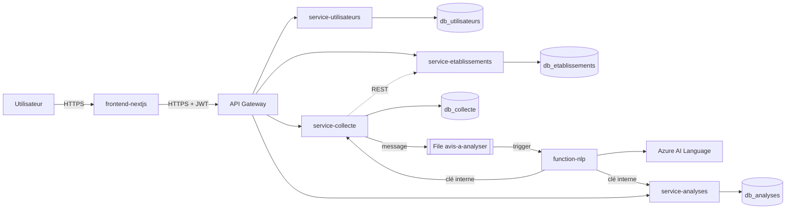

# 2. Architecture

## Vue d'ensemble

Les services (App Service, PaaS) et la Function (FaaS) tournent hors de la VM. Les quatre bases sont sur la VM Azure (IaaS).
**API Gateway** : l'architecture du TP en prévoit une. Option économique retenue : les routes serveur de Next.js jouent ce rôle
(point d'entrée unique, URLs internes cachées). Option production : Azure API Management.

## Découpage en microservices

| Service | Responsabilité métier | Données possédées | Dépend de |
|---|---|---|---|
| `service-utilisateurs` | Identité, connexion, rôles | `db_utilisateurs` | - |
| `service-etablissements` | Référentiel des établissements | `db_etablissements` | - (valide les jetons) |
| `service-collecte` | Réception et suivi des avis | `db_collecte`, file `avis-a-analyser` | `service-etablissements` (REST) |
| `service-analyses` | Résultats d'analyse et indicateurs | `db_analyses` | - |
| `function-nlp` | Analyse de sentiment automatique | aucune | file, `service-analyses`, `service-collecte`, Azure AI Language |

**Justification du découpage.** Chaque service correspond à un besoin métier distinct, qui évolue à son rythme et se déploie seul :
l'identité change peu et doit être très sécurisée ; les établissements sont un référentiel stable ; la collecte reçoit des écritures
fréquentes ; les analyses sont surtout lues. Chaque base n'est accessible que par son service.

## Communications

| De -> vers | Mode | Contenu | Authentification |
|---|---|---|---|
| Navigateur -> services | REST, JSON, HTTPS | requêtes métier | jeton JWT (rôle vérifié par chaque service) |
| collecte -> établissements | REST synchrone | existence d'un établissement | jeton JWT de l'utilisateur transmis |
| collecte -> Function | file de messages (asynchrone) | `{avis_id, texte, langue}` | chaîne de connexion du Storage |
| Function -> analyses / collecte | REST | résultat, nouveau statut | clé interne `X-API-Key` |

Gestion des erreurs : codes HTTP explicites (401, 403, 404, 409, 422, 502, 503). Reprises : la file réessaie 5 fois puis isole le
message en poison queue ; les écritures de la Function sont idempotentes ; `POST /avis/renvoyer-nouveaux` rattrape les avis
dont l'envoi en file a échoué.

## IaaS : la machine virtuelle

| Point | Choix |
|---|---|
| Système | Ubuntu 22.04 LTS : support long, PostgreSQL 14 dans les dépôts officiels |
| Taille | `Standard_B1s` (burstable) : charge faible et irrégulière d'un prototype. `B2s` si la mémoire manque |
| Ports ouverts | 22 (SSH) limité à l'IP de l'équipe. 5432 uniquement depuis le sous-réseau des App Service, jamais depuis Internet |
| Stratégie d'accès | Clé SSH uniquement, pas de mot de passe ; tunnel SSH pour l'administration des bases |
| Sécurisation | Pare-feu NSG, `scram-sha-256`, rôle applicatif sans droits superutilisateur, mises à jour de sécurité automatiques |
| Coût | Voir `04-finops.md` ; arrêt automatique à 22h00 |
| Pourquoi IaaS | Contrôle complet du moteur de base de données et de sa configuration. Compromis honnête : on assume l'exploitation (mises à jour, sauvegardes) |

## PaaS : Azure App Service

| Point | Choix |
|---|---|
| Pourquoi | Les 4 API n'ont besoin que d'un runtime Python : Azure gère système, correctifs, HTTPS et mise à l'échelle |
| Plan | Un plan Linux unique partagé par les 4 applications (B1 pour la démonstration) |
| Configuration | Commande de démarrage `uvicorn`, build par Azure à partir de `requirements.txt` |
| Variables d'environnement | Paramètres d'application Azure (voir `05-deploiement.md`), jamais dans le dépôt |
| Connexion aux autres services | HTTPS entre App Service ; intégration au réseau virtuel pour joindre PostgreSQL sur la VM |
| Avantages sur une VM | Pas de système à patcher, déploiement par GitHub Actions, HTTPS fourni, scale out par curseur |

## FaaS : Azure Functions

Voir `function-nlp/README.md` (trigger, entrée, traitement, résultat, raison du serverless).

## Données

| Point | Choix |
|---|---|
| Technologie | PostgreSQL 14, une base par service |
| Chaînes de connexion | Paramètres d'application Azure ; en local, fichier `.env` ignoré par Git |
| Sauvegarde | `pg_dump` quotidien de chaque base vers un conteneur Blob du Storage Account (cron sur la VM), plus instantané de disque avant changement majeur |
| Données sensibles | Adresses e-mail et empreintes de mots de passe (`db_utilisateurs`) ; contenu des avis |
| Validation | Modèles Pydantic (longueurs, bornes, formats) + contraintes SQL (`CHECK`, `UNIQUE`) |
| Erreurs de connexion | Exceptions journalisées, réponse 5xx, aucune information interne exposée au client |

## Limites connues et évolution

- **Principale faiblesse** : une seule VM pour toutes les bases est un point de défaillance unique, sans haute disponibilité
  et avec une sauvegarde à fiabiliser.
- **De 100 à 100 000 utilisateurs** : plusieurs instances d'App Service derrière un équilibreur, pool de connexions (PgBouncer),
  base managée avec réplicas de lecture, Function en montée en charge automatique, cache pour les lectures du tableau de bord.
- **Supprimer l'IaaS ?** Oui, techniquement : Azure Database for PostgreSQL Flexible Server remplace la VM et apporte sauvegardes
  et haute disponibilité. On la garde ici parce que le TP l'exige et pour garder la main sur le moteur.
- **Pour une vraie production** : base managée, Key Vault et identités managées à la place des secrets en paramètres, Private Endpoints,
  API Management, signature asymétrique des jetons ou Microsoft Entra ID, Application Insights et alertes, environnements séparés.
